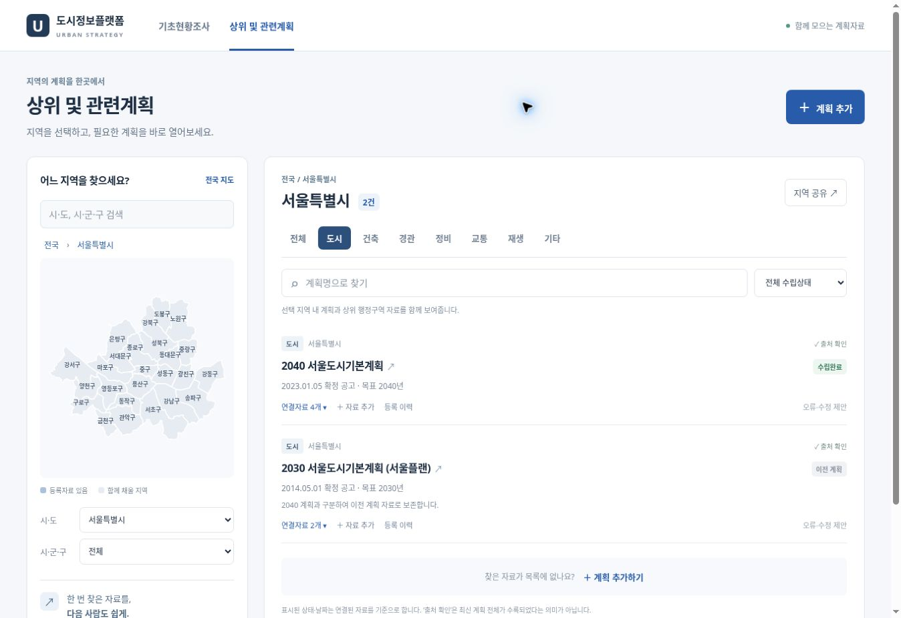

# 상위 및 관련계획 — 링크 공동등록 기능

기초현황조사 플랫폼에서 `/plans`로 연결한다. 행정구역을 선택하면 해당 지역 내 계획과 상위 행정구역의 계획을 함께 보여주며, 계획 제목에서 원문을 연다. 서울 도시정비 사업판정이나 공간 FACT에는 개입하지 않는다.



## 제공 기능

- 전국 시도 → 시군구 → 일반구 지도·목록 선택. 지역명 검색, 분야/수립상태/계획명 검색, 지역 주소 공유.
- 서울 초기자료 9개 계획, 공식기관 자료 링크 19개. 다른 지역은 비어 있는 공동등록 목록으로 시작한다.
- 누구나 새 계획 또는 기존 계획의 추가 링크 등록. 즉시 공개하되 **사용자 등록**으로 구분한다.
- 목표연도와 추진이력 날짜를 분리한다. 연도/연월/날짜만 아는 경우 그 정밀도대로 저장한다. 발주·수립 중·공람·완료·변경·이전 계획을 별도로 보존한다.
- 같은 지역·분야·계획명 중복 방지. 같은 계획 내 URL의 http/https, 추적쿼리, fragment 차이는 동일 링크로 취급한다.
- 오류·수정 제안, 공개 변경이력, 관리자의 계획정보 수정/출처확인/숨김/복원. 링크 오류는 기존 링크를 숨기고 새 링크를 추가할 수 있다.

계획 간 법정 상하위 관계를 자동 판정하지 않는다. 행정구역에 따른 자료 탐색 기능이다. 초기자료의 모든 분야·최신 변경분이 완비되었다는 의미도 아니다. 확인하지 못한 수립일을 게시일로 추정하지 않고, 날짜의 종류를 함께 표시한다.

## 실행과 저장

기존 `app.py`가 모듈을 등록한다. 기존 Dockerfile의 FastAPI/Pydantic/psycopg로 실행되므로 추가 서비스는 필요 없다. 관리페이지 `/plans/manage`와 관리 API는 기존 `_admin_auth_or_session`을 재사용한다.

공동등록에는 다음 중 하나의 **지속 가능한 저장소**를 설정한다.

| 우선순위 | 설정 | 용도 |
|---|---|---|
| 1 | `RELATED_PLANS_DATABASE_URL` | 별도 PostgreSQL 연결 |
| 2 | 기존 `DATABASE_URL` | 기존 PostgreSQL에 독립 `rp_` 테이블 생성 |
| 3 | `RELATED_PLANS_DB_PATH` | 영구 디스크의 SQLite 파일 절대경로 |
| 4 | `/var/data`가 존재 | `/var/data/related_plans.sqlite3` 사용 — 실제 영구 디스크 마운트 필요 |
| 없음 | 설정 없음 | 초기자료 조회 전용. 등록 버튼을 비활성화하고 API는 503 반환 |

Render의 임시 파일시스템을 공동등록 저장소로 묵시적으로 사용하지 않는다. SQLite 경로는 운영자가 영구 디스크로 지정해야 한다. 여러 인스턴스/호스트에서는 PostgreSQL을 사용한다. DB 접속이 실패하면 조회 오류를 표시하며 브라우저 저장으로 우회하지 않는다.

첫 조회 시 테이블과 초기자료를 멱등 생성한다. 재시작해도 기존 변경·숨김 기록을 덮어쓰지 않는다. PostgreSQL 초기화/중복검사는 트랜잭션 advisory lock, 관리자 변경은 version 비교로 동시수정을 보호한다. 저장 테이블:

| 테이블 | 보관 내용 |
|---|---|
| `rp_plans` | 지역, 분야, 계획명, 목표연도, 수립상태, 추진일자·종류, 메모, 출처확인, version, 숨김 |
| `rp_links` | 계획 ID, URL, 표시명, 자료종류, 메모, 출처확인, 숨김 |
| `rp_history` | 변경 동작, 이전 정보, 처리 사유, 시간 |
| `rp_reports` | 오류/수정 제안, 접수·처리 상태 |
| `rp_limits` | 익명 요청빈도 제한 버킷. 오래된 버킷 정리 |

조회 API는 `schema_version: 1`을 반환한다. 추후 계획 요약·보고서 연계는 계획 ID에 추가 테이블을 연결할 수 있다. 지금은 계획 원문을 업로드·수집·요약하지 않는다.

## 운영 관리

`/plans/manage`에서 기존 관리자 로그인으로 검토한다. 운영자의 계획정보 수정 후 출처확인은 해제되므로 다시 검증 후 표시한다. 숨김은 원본과 이력을 지우지 않는다. 보고된 제안은 확인 후 처리 완료로 변경한다.

기본 공개 쓰기 제한은 접속 주소별 10분당 20회다. `RELATED_PLANS_RATE_SALT`를 비밀 난수로 설정할 수 있다. 주소는 직접 저장하지 않고 시간 구간과 함께 해시한다. ASGI의 `request.client`를 사용하므로 프록시를 쓰는 운영환경에서는 신뢰할 프록시 범위를 정확히 설정해야 한다. 미설정 시 이용자들이 같은 프록시 제한을 공유할 수 있다. 이것은 익명 등록의 최소 제한이며 본격적인 남용 방지/계정 체계는 추후 확장 대상이다.

공개 쓰기는 same-origin 확인과 사용자정의 헤더를 요구한다. 등록 링크는 HTTP/HTTPS와 공개 도메인 형식만 허용하며, 서버가 사용자 URL에 접속하지 않는다. 사용자 내용은 DOM `textContent`로 렌더링한다. 외부 링크는 새 탭과 noopener/noreferrer를 사용한다. 출처확인·관리자 필드는 공개 등록에서 위조할 수 없다.

백업은 기존 PostgreSQL 백업 정책 또는 SQLite backup API를 이용한다. 새 배포에서 `rp_` 테이블을 삭제하지 않는다. 모듈 등록과 진입 링크를 되돌려도 자료는 보존된다.

## 자료 근거

각 초기자료의 원문과 고시 링크, 확인일, 날짜종류는 `plan_catalog_assets/seoul-plans.json`에 있다. 확인일: 2026-11-11. 서울시 도시공간포털, 분야별 정보, 도시재생포털, 서울시보, AURUM, 서초구 공식 자료를 사용했다. 2030 서울플랜과 2040 서울도시기본계획을 별도 보존한다.

행정구역 참고 지도: [vuski/admdongkor 2026-10-01](https://github.com/vuski/admdongkor/tree/master/ver20261001), SGIS 경계 가공. 출처·이용조건·원본 SHA256을 `regions.json`, `BOUNDARY_LICENSE.txt`에 포함한다. 2026년 행정구역 개편은 [토지이음 안내](https://www.eum.go.kr/web/in/al/alBoardDet.jsp?bd_type=1&gbn=I&seq=1636)에서도 확인된다. 지도의 경계는 행정구역 선택용이며 기존 FACT의 대상지·편입 판정에 쓰지 않는다.

지도를 재생성할 때 원본 GeoJSON은 저장소 밖에 내려받고 다음을 실행한다.

```bash
python scripts/build_plan_regions.py /path/to/HangJeongDong_ver20261001.geojson plan_catalog_assets
```

## 검증

```bash
python -m pytest tests/test_related_plans.py -q
node --check plan_catalog_assets/plans.js
node test_development_ui.cjs
python -m py_compile related_plans.py app.py
```

24개 API 검사: 다른 클라이언트/재시작 후 공유 저장, 상위지역 조회, 동시 중복 등록, 잘못된 날짜·URL·출처확인 위조, 인증·교차 출처 요청, 관리자 version 충돌, 정보수정·숨김·복원, 초기자료 재적재 보존, 공유 요청 제한. 기존 UI 검사와 앱 통합 경로(`/`, `/plans`, `/api/related-plans`, `/api/development/ui.js`) 응답도 확인했다.

브라우저 QA에서 서울 지도 클릭, 분야·검색, 다른 지역의 빈 목록, 새 계획 등록, 중복 링크 차단, 추가 링크, 수정 제안, 서버 재시작 후 자료 유지를 확인했다. 390px iframe으로 모바일 배치와 입력창을 점검하고 가로 넘침을 수정했다. 별도 임시 SQLite로 수행하여 테스트 입력은 초기자료나 운영 DB에 섞이지 않는다. PostgreSQL 실제 서버 접속, 운영 관리자 세션, 운영 영구 저장소, 대상지별 기존 외부 API·정비사업 분석 전체는 이 작업환경에서 검증하지 않았다. 운영 반영 전에 실제 배포환경에서 DB 등록·재시작 유지 확인이 필요하다.
